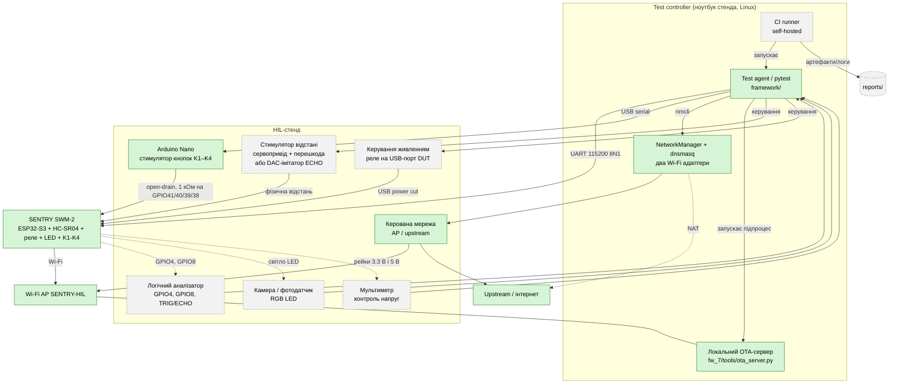

# HIL-стенд для SENTRY SWM-2: повна архітектура і поточна реалізація

Мета HIL-стенда: стимули на DUT подає не оператор, а test-агент, спостереження збирає не людина очима, а прилади, а CI запускає весь прогін сам.
Документ описує **повний (теоретичний) стенд** і для кожного вузла позначає статус у цьому проєкті:

- **Реалізовано**: працює, є код і докази прогонів;
- **Частково**: є основа, частина функцій лишилась ручною;
- **Теоретично**: не збиралось, лишається описом наступного кроку. Ці вузли навмисно збережено: вони показують, куди розвивається стенд.

Реалізовані етапи описані окремо: [`hil_button_stage.md`](hil_button_stage.md) (Arduino-кнопки) і [`managed_ap.md`](managed_ap.md) (керований Wi-Fi).
Результати прогону: [`../logs/hil/README.md`](../logs/hil/README.md).

Опис спирається на реальні обмеження, які вилізли під час тестування: HC-SR04 потребує активного заміру, Guard має часові вікна, консоль під час OTA не приймає команд, збите калібрування сонара дає хибні результати, а перемикання мережевих профілів на ноутбуці може саме розірвати Wi-Fi плати.

## 1. Схема



Зелені вузли реалізовано, сірі пунктирні лишаються теорією.

## 2. Компоненти і статус

| Вузол | Навіщо | Як | Статус |
|---|---|---|---|
| DUT (ESP32-S3) | об'єкт тестування | UART 115200 8N1, драйвер у `framework/drivers` | Реалізовано |
| Test controller | виконує pytest, подає стимули, збирає докази | `framework/`: UART-драйвер, парсер протоколу, редактор паролів, транскрипти, `results.json`, трасабіліті | Реалізовано |
| Стимулятори кнопок | натискання/утримання без оператора | Arduino Nano (`hardware/button_stimulator/`), serial-протокол `PRESS/HOLD/STOP`, A2–A5 через 1 кОм на GPIO41/40/39/38, програмний open-drain | Реалізовано (оптопари для постійного стенда рекомендовані, поки прямий резистивний зв'язок) |
| Керована мережа (AP / upstream) | детермінований обрив Wi-Fi для WF-5, OTA-9, OTA-16 | ноутбук з двома Wi-Fi адаптерами: вбудований роздає AP `SENTRY-HIL`, USB-донгл дає upstream; керування через NetworkManager (`framework/drivers/managed_ap.py`), DHCP/NAT через dnsmasq | Реалізовано (замінила розетку з реле на роутер) |
| Локальний OTA-сервер | fault-injection: обрив, повільне завантаження, зіпсовані образи | `fw_7/tools/ota_server.py`; для slow OTA тест сам запускає його підпроцесом (`drivers/ota_server_process.py`) і вимикає AP на 10% завантаження | Реалізовано |
| Збір доказів | транскрипти кожного тесту, логи прогонів, трасабіліті | `--keep-logs`, `docs/results.json`, `gen_traceability.py` | Реалізовано |
| Керування живленням | power loss / power cycle (OTA-9, збереження даних) | реле на лінії живлення DUT, кероване контролером | Теоретично (зараз замість цього програмний `reboot`) |
| Стимулятор відстані | подати відстань до HC-SR04 без руки | сервопривід з перешкодою або генератор імпульсів на ECHO | Теоретично (зараз перешкода ставиться вручну) |
| Логічний аналізатор | перевірка GPIO4/GPIO8 напряму | sigrok/Saleae на GPIO4, GPIO8, TRIG/ECHO | Теоретично |
| Камера / фотодатчик | об'єктивна перевірка кольору/патерну LED | USB-камера + OpenCV | Теоретично (зараз очима) |
| Мультиметр | контроль напруг | перед першим увімкненням і за потреби | Теоретично |
| CI runner | запуск стендових прогонів без людини | self-hosted runner на ноутбуці стенда | Теоретично (зараз запуск вручну; прапорці `--run-hil` і `--run-managed-wifi` уже відокремлюють стенд від звичайних тестів) |

## 3. Чому саме такі стимулятори

**Відстань.** HC-SR04 не моніторить нічого у фоні: жодна подія (alarm, collision, intrusion) не спрацьовує без явного `distance`/`distance log`, а `guard arm` без показання дає `E805`. Тому стимулятор відстані має бути синхронізований з тест-агентом: спершу запускаємо вимір, потім рухаємо перешкоду. Практичний урок: збите калібрування сонара (показання 8–9 см або `E702`) породжувало хибні SKIP/FAIL у HIL-GD-07; з еталонною перешкодою на сервоприводі перед кожним прогоном можна було б перевіряти калібрування автоматично.

**Guard.** Часові вікна (10 с arming, 15 с до ALARM) вимагають, щоб стимул був точним у часі, інакше перевіряється «колись», а не межа вікна.

**Кнопки.** Прошивка розрізняє короткий press, hold 1,5 с і комбінації 2 с. Тривалістю імпульсу керує Arduino, а не людина. На практиці комбінацію тримають 2,2 с: на точній межі 2,0 с прошивка інколи бачить release раніше за hold. Arduino відповідає лише за стимул; реакцію DUT перевіряє pytest через UART.

**Wi-Fi.** Різні відмови мають різні наслідки, тому їх треба розрізняти: втрата AP (`W110`, до цього `ota check` ще відповідає `E402`, після `E002`), втрата upstream при живому AP (`E411` або `E402` залежно від прапорця `internet`), недоступний OTA-сервер (`E402`). Урок зі стенда: сама команда `nmcli connection up` для вже активного AP перезапускає його і розриває Wi-Fi плати, тому baseline піднімає лише неактивні профілі.

**GPIO4/GPIO8.** Рівень індикаторного діода і реле видно тільки очима або приладом. З логічним аналізатором вони перевірялись би автоматично й одразу, а не через кілька днів ручного спостереження.

**OTA.** Консоль під час завантаження не приймає команд, тому E401 (друге OTA під час першого) з консолі недосяжний; такі сценарії перевіряються через фізичний/мережевий стимул у потрібний момент (обрив AP за прогресом `[OTA] 10%`).

## 4. Теоретичні розширення мережевого стимулятора

Поточний керований AP закриває обрив AP і втрату upstream. Решта мережевих помилок з WF-2 потребує інших стимулів, які **не реалізовано**:

| Помилка | Стимул, який дав би її детерміновано |
|---|---|
| `E103` непідтримуване шифрування | другий SSID на тому ж ноутбуці з WEP/Open/WPA3-only |
| `E104` немає DHCP | AP профіль без dnsmasq (статична адресація, DHCP вимкнено) |
| `E105` немає інтернету (DNS) | блокування DNS/WAN правилами фаєрвола лише для клієнтів AP |
| `W106` NTP недоступний | блокування UDP 123 для клієнтів AP |
| `W107` слабкий сигнал | керований атенюатор на антені або AP на відстані |

Важливо: такі відмови не слід імітувати вимкненням AP, бо це інший тип помилки.

## 5. Безпека

- Живлення на DUT — через струмообмежене джерело.
- Перед будь-якою новою комутацією — перевірка continuity без подачі живлення.
- Реле стимуляторів за замовчуванням у стані "не заважати" (нормально замкнені), щоб збій контролера не лишив DUT без живлення посеред запису.
- Жоден стимулятор не подає напругу вище задокументованої: 3.3 В логіка ESP32, 5 В лінії (Echo HC-SR04) лише через рівневий перетворювач.
- **Arduino Nano працює від 5 В, ESP32-S3 від 3,3 В.** У поточній реалізації Nano ніколи не подає `HIGH`: натиснуто = `OUTPUT/LOW` через 1 кОм, відпущено = `INPUT` (high-Z). Для постійного стенда рекомендовані оптопари або NPN/open-collector каскади.
- Максимальна тривалість `HOLD` обмежена 10 с у прошивці Nano, щоб кнопка не лишилась натиснутою; але `HOLD` блокуючий (`delay()`), `STOP` його не перериває, тож аварійне відпускання забезпечується лише цією межею.
- Керування мережею ноутбука — лише іменовані профілі (`SENTRY-HIL`, upstream). Глобальні дії (`nmcli radio wifi off`, `nft flush ruleset`) у тестах заборонені: це зламає upstream і сам стенд одночасно.
- Emergency stop — окрема фізична кнопка на лінії живлення, незалежна від test-агента.

## 6. CI/CD (теоретично)

```text
git push → self-hosted runner (ноутбук зі стендом)
  → health-check стенда (порти, nmcli, Nano відповідає PONG, калібрування сонара)
  → erase-flash + прошивка потрібної версії
  → smoke → functional + boundary
  → HIL-кнопки (--run-hil)
  → керований Wi-Fi і OTA fault-injection (--run-managed-wifi)
  → Guard/Alert сценарії з точним таймінгом і стимулятором відстані
  → збір артефактів: логи, транскрипти, знімки аналізатора, фото LED
  → публікація звіту, оновлення results.json і traceability.md
```

Runner має бути self-hosted, не хмарний: тести торкаються реального заліза. `gen_traceability.py` уже будує матрицю з `results.json`, тож у CI це ще один крок. Стендові стадії вмикаються явними прапорцями, тож звичайний прогін (`unit`, `functional`) не торкається Arduino і мережі ноутбука.

## 7. Що автоматизується, а що ні

| Категорія | На повному стенді | Статус у проєкті |
|---|---|---|
| Коди помилок, межі, OTA-логіка | повністю | реалізовано (`framework/tests`) |
| Кнопки, комбінації, `E003`/`E302`/`E005` | повністю, Arduino з точним таймінгом | реалізовано (HIL-стадія) |
| Дребезг кнопок (електричний) | імітація швидкого перемикання на оптопарі | теоретично; зараз перевіряється лише класифікація press/hold |
| Обрив Wi-Fi у потрібний момент (WF-5, OTA-16, OTA-25) | повністю, керований AP/upstream | реалізовано |
| Мережеві помилки `E103/E104/E105/W106/W107` | окремі стимули (розділ 4) | теоретично |
| GPIO4/GPIO8 напряму | повністю, логічний аналізатор | теоретично |
| Відстань HC-SR04, Guard-сценарії з рухом | повністю, сервопривід/DAC | теоретично (зараз перешкода вручну) |
| Колір і режим RGB LED | частково: камера впізнає колір і базовий патерн, але не "чи гарно виглядає" | теоретично |
| Втрата живлення, power cycle | повністю, реле на живленні DUT | теоретично (зараз програмний `reboot`) |
| Клацання реле (звук) | непрямо, через GPIO8, а не на слух | теоретично |
| Глибина/тиск/вологість (симулятор) | не застосовується: PRD каже, що це модельні значення, на логіку не впливають | — |

## 8. Що реалізовано в цьому проєкті, а чого нема

Проєкт пройшов три стадії:

1. **Ручний стенд + UART-автоматизація.** Усі команди й межі перевіряються програмно; фізичні речі (LED, діод, реле, сонар) оператор бачить очима. Закрито 2.1.0 повністю.
2. **Arduino HIL для кнопок.** Фізичне натискання K1–K4 з точною тривалістю, перевірка реакції через UART. Докази: `logs/hil/` ([`hil_button_stage.md`](hil_button_stage.md)).
3. **Керований Wi-Fi.** AP і upstream керуються з тест-агента, OTA-сервер піднімається тестом; обрив AP у потрібний момент, включно з повільним OTA. Докази: `logs/hil/` ([`managed_ap.md`](managed_ap.md)).

Частина тестів лишається повністю або частково ручною: LED/діод/реле, відстань для Guard і сонара, power cycle, мережеві помилки з розділу 4. Саме вони є аргументом, чому подальші вузли (логічний аналізатор, камера, стимулятор відстані, керування живленням) варті окремого кроку: вони прибирають останню частину тестування, що залишається ручною.
